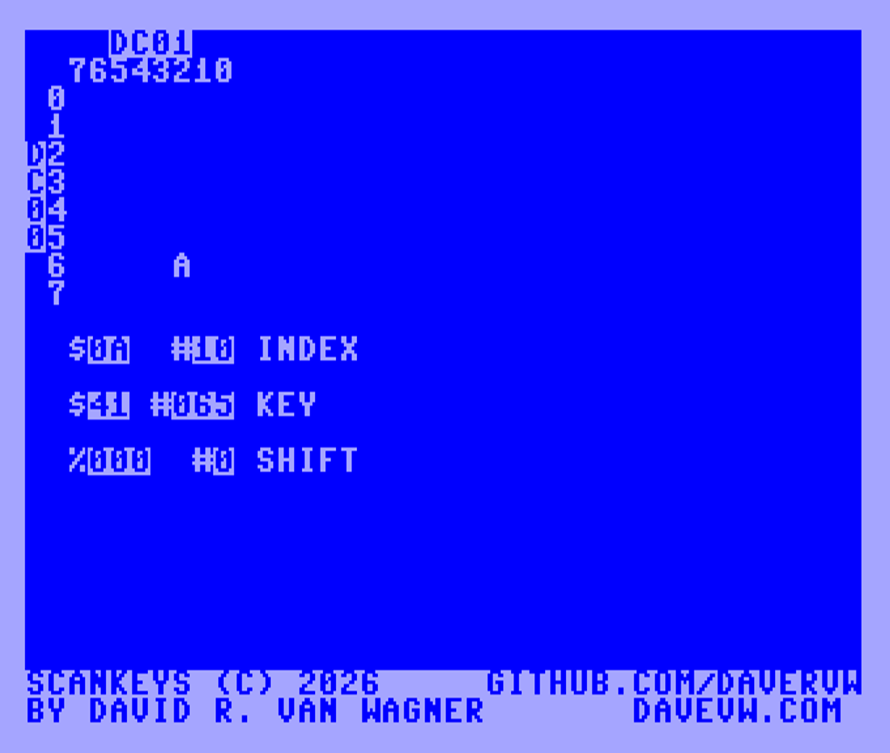
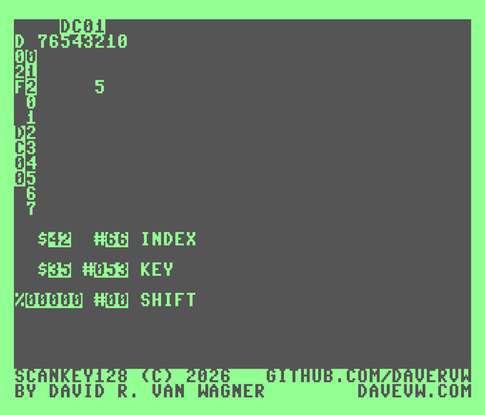
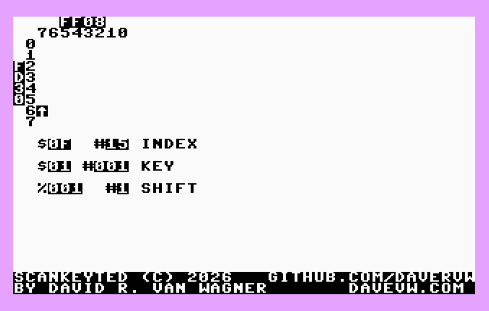

# scankeys - demo Commodore 64, 128, and 264 keyboard matrix #

Actively scan Commodore 64/128/264 keyboard matrix and display pressed keys on screen

(264 family includes Commodore 116, 16, plus/4)

C64 Usage (supports 64 keys):

````
LOAD "SCANKEY64 49152",8,1
SYS 49152
````

C128 Usage (supports 90 keys):

````
LOAD "SCANKEY128 1700",8,1
SYS DEC("1700")
````

64 mode support of 128 keys (supports 89 keys, all but 40/80 DISPLAY because MMU disabled) Usage:

````
GO 64
LOAD "SCANKEY64MODE",8,1
SYS 49152
````

TED Usage (supports 64 keys on plus/4, 116, 16):

````
LOAD "SCANKEYTED 1004",8,1
SYS DEC("1004")
````

STOP+RESTORE may get you to a BASIC prompt if you are lucky (except TED machines have no RESTORE), keep trying (hold STOP, tap RESTORE repeatedly).  Otherwise reset system.

Also see project [c-keymaps](https://github.com/davervw/c-keymaps) for more keyboard resources






